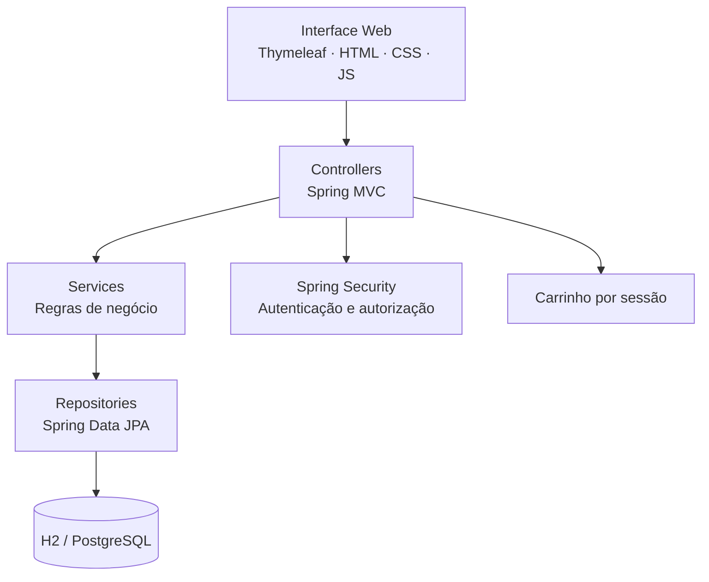

<div align="center">

# 🎓 Nevez Campus

### Gestão acadêmica e marketplace em um só lugar

**Uma aplicação web completa para organizar pessoas, cursos, produtos e pedidos — com segurança e uma interface moderna.**

<br/>


<br/>


<br/>

[Funcionalidades](#-funcionalidades) • [Tecnologias](#-tecnologias) • [Como executar](#-como-executar) • [Arquitetura](#-arquitetura) • [Créditos](#-créditos)

</div>

---

## ✨ Visão geral

O **Nevez Campus** combina gestão acadêmica com controle de produtos e pedidos. O painel de administração permite acompanhar informações da instituição, enquanto a loja oferece catálogo e carrinho para usuários autenticados.

> **Projeto de estudo e desenvolvimento.** A aplicação é executada localmente; o repositório não representa um serviço público hospedado.

## 🧩 Funcionalidades

| Módulo | O que é possível fazer |
| :--- | :--- |
| 🎯 **Dashboard** | Visualizar indicadores, últimos pedidos e produtos com estoque baixo |
| 🎓 **Acadêmico** | Gerenciar alunos, professores, cursos e disciplinas |
| 👥 **Usuários** | Administrar contas e permissões por perfil |
| 🛍️ **Marketplace** | Navegar pelos produtos, pesquisar e usar um carrinho individual por sessão |
| 📦 **Estoque** | Cadastrar produtos, controlar quantidades e validar disponibilidade |
| 🧾 **Pedidos** | Registrar itens, calcular totais e acompanhar os estados de cada pedido |
| 🔐 **Acesso** | Login, autenticação, autorização e recuperação de senha por email |

## 🛠️ Tecnologias

- **Backend:** Java 17, Spring Boot 4, Spring MVC, Spring Data JPA e Spring Security
- **Frontend:** HTML, CSS, JavaScript e Thymeleaf
- **Banco de dados:** H2 persistente no desenvolvimento e PostgreSQL como opção
- **Build e testes:** Maven Wrapper e JUnit
- **Segurança:** BCrypt, CSRF nos formulários e perfis de acesso

## 🚀 Como executar

**Requisitos:** JDK 17 ou superior. O Maven Wrapper está incluído no projeto; não é necessário instalar o Maven separadamente.

**1. Clone o repositório**

```bash
git clone https://github.com/Nevez06/DevOps.git
cd DevOps
cd devops
```

**2. Configure um usuário administrador (PowerShell no Windows)**

```powershell
$env:APP_BOOTSTRAP_ENABLED="true"
$env:APP_ADMIN_PASSWORD="escolha-uma-senha-forte"
```

**3. Inicie a aplicação**

```powershell
.\mvnw.cmd spring-boot:run
```

**Acesse:** [http://localhost:8080/login](http://localhost:8080/login)

Use o login `admin` e a senha configurada em `APP_ADMIN_PASSWORD`. O banco H2 será criado localmente na pasta `devops/data/` (relativa à raiz do repositório).

<details>
<summary><b>🐧 Linux ou macOS</b></summary>

```bash
APP_BOOTSTRAP_ENABLED=true APP_ADMIN_PASSWORD='escolha-uma-senha-forte' ./mvnw spring-boot:run
```

</details>

<details>
<summary><b>🐘 Usar PostgreSQL</b></summary>

Crie um banco PostgreSQL e informe as variáveis de conexão:

```powershell
$env:DB_URL="jdbc:postgresql://localhost:5432/nevez_campus"
$env:DB_USERNAME="postgres"
$env:DB_PASSWORD="senha-local"
.\mvnw.cmd spring-boot:run "-Dspring-boot.run.profiles=postgres"
```

</details>

<details>
<summary><b>✉️ Configurar recuperação de senha</b></summary>

Defina as variáveis `MAIL_USERNAME`, `MAIL_PASSWORD` e `APP_BASE_URL`. Para Gmail, configure uma **senha de aplicativo**. Os links de recuperação expiram em **30 minutos** e não são exibidos nos logs.

</details>

## 🏗️ Arquitetura



Estrutura simplificada, com o projeto dentro de **`devops/`**:

```text
DevOps/
├── .vscode/
│   └── settings.json        # Configurações do VS Code
├── devops/                  # Projeto Java completo
│   ├── .mvn/wrapper/
│   ├── docs/
│   ├── src/
│   │   ├── main/
│   │   │   ├── java/br/com/nevez/devops/
│   │   │   └── resources/
│   │   └── test/
│   ├── pom.xml
│   ├── mvnw
│   └── mvnw.cmd
└── README.md
```

Veja também a [documentação da arquitetura](devops/docs/ARQUITETURA.md).

## ✅ Qualidade e segurança

O projeto inclui testes automatizados com JUnit, executados localmente pelo Maven. Na raiz do repositório, entre na pasta `devops` e rode:

```powershell
cd devops
.\mvnw.cmd test
```

As contas de demonstração são **desativadas por padrão** e só são criadas em um banco vazio quando `APP_BOOTSTRAP_ENABLED=true`. Senhas devem ser configuradas no ambiente, não no código. O arquivo `src/test/resources/application.properties` contém dados exclusivamente para testes.

**Importante:** o projeto precisa de avaliação adicional de segurança, migrações versionadas de banco de dados e preparação de infraestrutura antes de ser colocado em produção.

## 👨‍💻 Desenvolvimento

Repositório mantido em **[Nevez06](https://github.com/Nevez06)**. Esta versão apresenta organização de pacotes, interface personalizada, atualizações de configuração e infraestrutura de testes.

### 🤝 Créditos

Este projeto foi desenvolvido a partir de uma base do repositório **[Adryan-Francisco/DevOps](https://github.com/Adryan-Francisco/DevOps)**, com adaptações e melhorias posteriores. A autoria das contribuições originais é preservada.

> O repositório de referência não apresentava licença explícita na consulta realizada. Para redistribuição e outros usos além dos permitidos por lei, confirme a autorização com o autor.

---

<div align="center">

**Feito com Java, Spring Boot e muita prática.** ☕

[↑ Voltar ao topo](#-nevez-campus)

</div>
